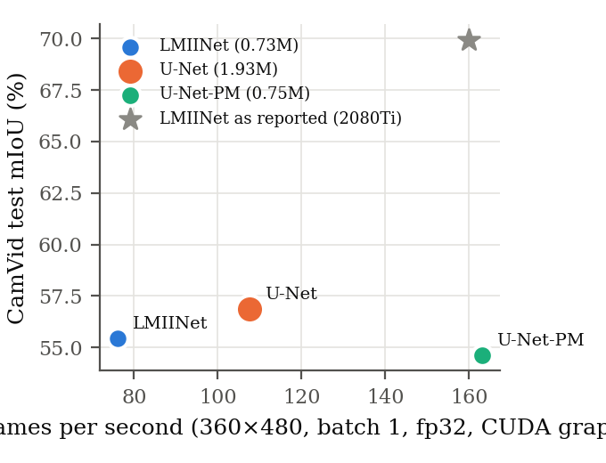
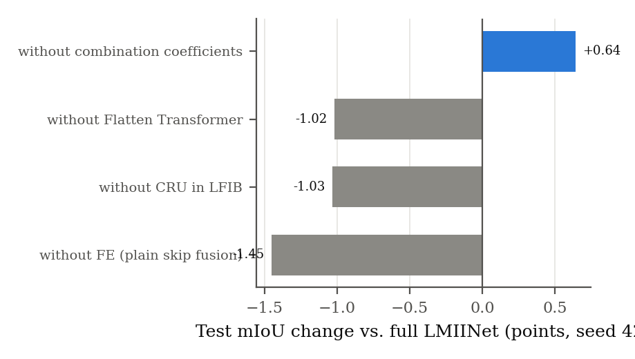
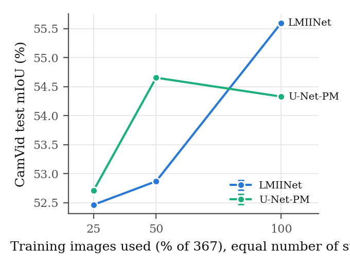
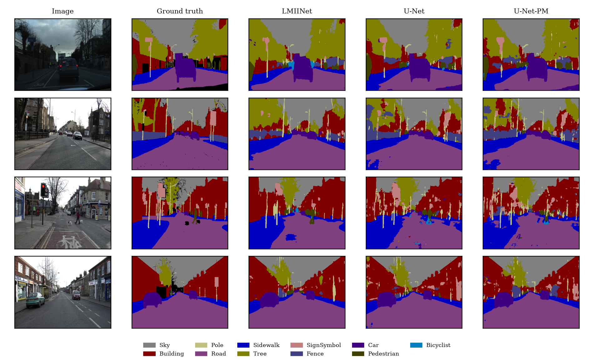

# Lightweight Real-Time Semantic Segmentation: Reproducing LMIINet on CamVid

Computer Vision (CSL7360), Course Project  
Prakhar Srivastava, B23CM1056 and Neer Bipinkumar Modi, B23CS1043  
9 November 2026

## 1. Problem

Semantic segmentation labels every pixel of an image. For a car or a robot the model has to do
this at frame rate on modest hardware, so accuracy is only half of the question; parameters,
compute and actual frames per second are the other half.

LMIINet (Qiu et al., 2024) claims an unusually good point on that trade-off: 0.72M parameters,
69.94% mIoU on CamVid at 160 FPS on an RTX 2080Ti. Its idea is *multiple-information
interaction*: inside each block, the local branch and the context branch feed each other a
learned, weighted copy of their output instead of running side by side, and the same trick
couples a linear-attention Transformer to a channel-attention block. The paper comes with no
code, leaves several architectural details open, and trains for a schedule it does not state.

The aim of this project, as submitted in the proposal, is to reproduce LMIINet from the paper
alone, train it from scratch on CamVid at a much smaller scale than the paper, and check whether
its efficiency and accuracy advantage over a standard U-Net of similar depth still holds.

## 2. Approach

### 2.1 LMIINet, rebuilt from the equations

`src/models/` implements every component the paper describes, with the equation numbers in the
docstrings:

| Component | File | What it does |
|---|---|---|
| LFIB block | `modules.py` | 1x1 conv, split into halves. Left half: 3x1 then 1x3 conv (local). Right half: dilated depthwise 3x3 then 1x1 (context). Each half receives the other's output scaled by a learned combination coefficient (CC, initialised to 0.5). A Channel Reconstruction Unit (CRU, from SCConv) adds a cheap channel path. Depthwise 3x3 and channel shuffle close the block. |
| Improved Flatten Transformer | `flatten_transformer.py` | Focused linear attention (focusing power p = 3, 4 heads, 5x5 depthwise conv on V), coupled to a channel attention block through a second CC. One block at 1/8 resolution. |
| Decoder | `modules.py`, `lmiinet.py` | Two long connections carry encoder detail to feature-enhancement modules at 1/4 and 1/2 resolution. |
| Segmentation head | `modules.py` | Concatenates decoder outputs from 1/2, 1/4 and 1/8, then two 1x1 convs. An auxiliary head at 1/8 adds 0.3 times its loss during training. |

The six LFIB stages hold two blocks each, the {2,2,2,2,2,2} configuration of the paper. The
result has **727,073 parameters**, against the paper's 0.72M. Where the paper is silent I made a
choice and wrote it down. Every such choice is listed in Appendix A of `report.pdf`; the ones
that matter most are the channel widths (32, 64, 128), the dilation rates, and treating each CC
as one learnable scalar.

The attention is the part most likely to be subtly wrong, so it is checked hardest. Linear
attention rewrites the row-normalised product $\mathrm{diag}(1/(QK^\top\mathbf 1))\,QK^\top V$ as
$Q(K^\top V)$ divided by $Q(K^\top\mathbf 1)$, which never forms the $N\times N$ matrix.
`src/tests.py` builds the explicit $N\times N$ version and compares: the whole attention module
agrees with it to 5.6e-16 in float64.

### 2.2 Baselines

LMIINet bottoms out at 1/8 resolution, so the U-Net here uses three down-sampling steps instead
of the original four. Two widths are trained:

| Model | Base width | Parameters | Why |
|---|---|---|---|
| U-Net | 32 | 1,927,339 | the standard U-Net of similar depth named in the proposal |
| U-Net-PM | 20 | 753,871 | parameter-matched to LMIINet, so a win cannot be put down to size |

Both counts are checked against a closed-form formula in the tests.

### 2.3 Training recipe

All models share the paper's CamVid recipe: Adam with $\beta_1 = 0.9$, learning rate $10^{-3}$,
weight decay $2\times10^{-4}$, batch size 8, and poly decay
$\mathrm{lr} = \mathrm{lr}_0\,(1 - \mathrm{iter}/\mathrm{max\_iter})^{0.9}$. Cross-entropy is
weighted per class with $w_k = 1/\ln(1.02 + p_k)$, since CamVid's thin classes (pole, sign,
bicyclist) are a few percent of the pixels. Augmentation is random scaling in [0.75, 1.75],
a 360x480 crop, horizontal flip and mild colour jitter. Every model trains from random
initialisation for 80 epochs (3,600 iterations), and the checkpoint with the best validation
mIoU is evaluated once on the 233 test images.

### 2.4 Making it run on a 6 GB laptop GPU

The first timing run took 75 s per LMIINet epoch, which put the experiment plan at well over ten
hours. Profiling found three separate causes, and fixing them is part of the engineering of this
project:

1. *Memory.* LMIINet keeps about thirty intermediate maps per block. In fp32 with batch 8 that
   is more than the 6 GB card holds, and Windows does not fail with an out-of-memory error; it
   silently spills to system RAM. Every kernel then ran 50 to 100 times slower (one bilinear
   upsample backward took 470 ms). Mixed precision (bf16) brings the peak to about 4 GB.
2. *Data loading.* PIL augmentation in Windows worker processes could not keep up, and the
   workers took a minute to start each run. The dataset is small enough to live on the GPU, so
   `src/data/gpu.py` keeps all images there and does scale, crop and flip as one batched affine
   `grid_sample` per batch (bilinear for the image, nearest for the labels, out-of-image pixels
   become void). A test checks that the warp reproduces the image exactly at scale 1 and mirrors
   it exactly under a flip.
3. *Kernel launches.* LMIINet runs about 700 small kernels per forward pass, and launching them
   costs more than computing them. Replaying the forward pass as a CUDA graph removes that cost;
   it is how the FPS figures below are measured (the eager figure is reported next to it). For
   training I also built a CUDA-graph trainer (`src/engine.py`), and a test shows it matches
   ordinary training to within the run-to-run noise of the GPU. It stays off by default: capture
   only works with cuDNN autotuning disabled, and the kernels cuDNN then picks made a training
   epoch twice as slow, which more than cancels the launches saved.

### 2.5 Measuring speed

Parameters are counted exactly. MACs (multiply-accumulates, which most segmentation papers call
"FLOPs") are counted with forward hooks on every convolution and linear layer, plus the
attention products, and the counter is tested against a hand-computed network. FPS is measured
at batch 1 on one 360x480 image after a warm-up, with the GPU synchronised before the clock is
read, both eagerly and as a CUDA-graph replay, in fp32 and fp16.

## 3. How to run

The project uses the shared course environment `assignments/.venv`. Everything runs from
`run.py`, and finished runs are skipped on a re-run, so an interrupted run can just be restarted.

```
run_all.bat                                   # Windows: double-click, uses ..\..\.venv
python run.py                                 # everything
python run.py --phase tests                   # correctness checks only
python run.py --phase main --epochs 80        # one phase
python run.py --full-ablation                 # also the three secondary ablations
python train.py --model lmiinet --epochs 80   # a single run
python evaluate.py --ckpt runs/lmiinet/best.pt --split test --eval-size 720 960
```

`run.py` downloads CamVid (the 11-class SegNet split) into `data/CamVid` on first use. Phases in
order: correctness tests, data, benchmark, main comparison, ablations, reduced-data study,
720x960 evaluation, figures and tables, report.

## 4. Results

All numbers come from `results/` and `runs/*/results.json`, which `run.py` writes; the report
(`report.pdf`) is built from the same files. CamVid test set (233 images) at 360x480.

### 4.1 Main comparison

Mean ± sample standard deviation over 3 seeds (42, 7, 123). FPS at batch 1 on the laptop
RTX 3060: eager PyTorch, and the same forward pass replayed as a CUDA graph.

| Model | Params | GMACs | FPS eager | FPS graph fp32 | FPS graph fp16 | Test mIoU (%) |
|---|---|---|---|---|---|---|
| LMIINet (ours) | 0.727M | 4.99 | 12.3 | 76.2 | 115.4 | 55.45 ± 0.58 |
| U-Net (base 32) | 1.927M | 24.36 | 109.5 | 107.6 | 170.7 | 56.87 ± 0.55 |
| U-Net-PM (base 20) | 0.754M | 9.57 | 154.8 | 163.1 | 255.5 | 54.64 ± 0.38 |
| LMIINet, paper (2080Ti) | 0.72M | n/r | 160 (mode not stated) | | | 69.94 |



Ranked by the mean, U-Net is first, LMIINet second and U-Net-PM third. U-Net is ahead of LMIINet in every seed (by 0.5 to 1.9 points). LMIINet's lead over the parameter-matched U-Net is smaller and less certain: ahead by 1.3 and 1.4 points in two seeds, behind by 0.3 in the third, a mean of 0.8 points. Welch's t-test on the three seeds separates U-Net from LMIINet (p = 0.04) but not LMIINet from U-Net-PM (p = 0.12). At the paper's parameter budget LMIINet is on par with a plain U-Net of the same size, which needs twice its MACs but runs twice as fast.

LMIINet is 14.49 points below the paper. We put most of the gap down to the training schedule.
Without a long run that cannot be proven, but the logs point the same way:

- none of the nine main runs had converged: each reached its best validation score in the last 15
  of its 80 epochs, and in every run the training loss over epochs 71 to 80 is still below that over
  epochs 61 to 70;
- related work from the same group trains CamVid for about 1000 epochs, roughly 45,000 updates at
  batch 8 against our 3,600, about twelve times as many;
- validation mIoU sits 7 to 12 points above test mIoU for every model (most for LMIINet), so a
  checkpoint chosen on validation does not keep its score on test.

Our own choices for the details the paper leaves open could explain part of the rest. The
decisive test is one LMIINet run of 300 to 1000 epochs with this code.

### 4.2 Where the time goes

LMIINet needs a fifth of U-Net's MACs but is the slowest of the three on this GPU. In eager
PyTorch it manages 12.3 FPS, because every one of its several hundred small kernels is
launched separately from Python; the same forward pass replayed as a CUDA graph runs at
76.2 FPS. U-Net, with few large kernels, runs at the same speed either way. Even as a graph
LMIINet stays behind both U-Nets, because depthwise, asymmetric and 1x1 convolutions on narrow
feature maps, plus the splits, concatenations and shuffles inside every block, are limited by
memory bandwidth, which no MAC count sees. The same property shows in memory: LMIINet's peak
training memory is 4.32 GB in bf16, more than either U-Net.

### 4.3 Ablations (seed 42)

| Variant | Params | Test mIoU (%) | Change |
|---|---|---|---|
| Full LMIINet | 0.727M | 55.60 | |
| without combination coefficients | 0.727M | 56.24 | +0.64 |
| without Flatten Transformer | 0.518M | 54.58 | -1.02 |
| without CRU | 0.570M | 54.56 | -1.03 |
| without feature enhancement | 0.725M | 54.15 | -1.45 |



The Transformer, the CRU and the feature-enhancement fusion each add one to one and a half
points. The combination coefficients, the interaction that gives LMIINet its name, add nothing
here: zeroing them gives a slightly higher score, and in the full model the learned values end
between 0.37 and 0.56 after starting at 0.5.

How far can single-seed ablations be trusted? Each is judged against the full model's three seeds
(55.45 ± 0.58). All four fall outside the range of those three runs (the removals below the lowest,
the no-CC run above the highest), but none is more than about two standard deviations away, and a
t-test against three reference runs gives p = 0.19 to 0.36. So the ablations show a consistent
direction, every removal hurts and removing the coefficients does not, rather than a measured
effect size.

Why can the coefficients add so little? The two halves they exchange are slices of the same
tensor, produced by one learnable 1x1 convolution, so injecting one half into the other is close
to a reparametrisation of what that convolution could already produce. The exchange into the
context branch does carry processed features, but the same mixing happens one step later anyway:
the halves are concatenated, added to the CRU output, shuffled, and combined again by the next
block's 1x1 convolution. The coefficients only move that exchange a layer earlier, which fits the
learned values: across 75 coefficients from three seeds the mean move from 0.5 is 0.04 and the
largest 0.13.

### 4.4 Less training data (seed 42, same number of steps)

| Model | 25% (92 images) | 50% (184) | 100% (367) |
|---|---|---|---|
| LMIINet | 52.47 | 52.87 | 55.60 |
| U-Net-PM | 52.71 | 54.65 | 54.33 |



LMIINet's lead over the size-matched U-Net at full data turns into a deficit at half and a tie at
a quarter. Against each model's three-seed spread at full data, LMIINet's drop is beyond seed
noise with a quarter of the images (p = 0.05) and borderline with half (p = 0.06); U-Net-PM is
unchanged with half (p = 0.97) and drops only with a quarter (p = 0.05). Its validation score stays near 68% at every fraction while test falls, so with less
data it fits the training distribution as well as before but generalises worse.

### 4.5 Per class and qualitative



Sky and road are above 89% IoU for every model, and sidewalk, building and tree between 67% and
76%. Thin classes are hard for all of them: pole, sign symbol and fence sit between 17% and 29%.
LMIINet's clearest gain is on bicyclist (39.9%, against 32.8% for U-Net and 30.1% for U-Net-PM);
U-Net leads on building, tree, pedestrian and car. Most thin-class errors are pixels given to
building: 34% of sign-symbol, 24% of fence and 17% of pole pixels
(`results/06_confusion_matrix.csv`).

### 4.6 Correctness of the implementation

`src/tests.py` runs before training and stops the pipeline on any failure; the last run is in
`results/00_unit_tests.csv` (18 of 18 pass). The checks that matter most:

| Check | Reference | Result |
|---|---|---|
| Linear attention | explicit N x N row-normalised attention | error 2.9e-7 |
| Whole attention module | slow re-implementation from the equations, float64 | error 5.6e-16 |
| mIoU and pixel accuracy | per-class set counting with void ignored | equal to 1e-9 |
| MAC counter | hand count for a small network | exact |
| U-Net parameter count | closed-form formula | exact |
| GPU augmentation | identity warp, flip, void padding | exact |
| CUDA-graph training step | two eager runs (GPU noise floor) | within the floor |

## 5. Discussion

### What worked

The reimplementation lands on the paper's parameter budget (727,073 against 0.72M) and the
architecture trains stably from scratch with the paper's optimiser settings. Against a U-Net with
the same number of parameters it is ahead at full data, and the components it adds around the
interaction idea (Transformer, CRU, feature enhancement) each measurably help.

### What did not

The headline idea did not show up. Removing the combination coefficients changed nothing, the
learned coefficients hardly moved from their initial value, and the block's structure explains
why: the exchange they add already happens one layer later. The efficiency claim also did not
transfer to this hardware: the network with the fewest MACs was the slowest of the three.

### What was fragile

Getting a 0.7M-parameter network to train quickly on a 6 GB laptop GPU under Windows took more
work than building it. fp32 activations silently spilled out of GPU memory and slowed everything
fifty-fold, PIL augmentation in worker processes starved the GPU, and eager kernel launches
dominated inference. Each fix is in the code and described in section 2.4.

### Where the data falls short

Accuracy is far below the paper, most likely because the schedule is about a twelfth as long
(section 4.1 gives the evidence). Three seeds are enough to show that U-Net beats LMIINet
(p = 0.04) but not to separate LMIINet from U-Net-PM. Ablations and the data study use one seed
each, so they show directions, not effect sizes. CamVid is small, and its validation set is much
easier than its test set.

### What a next iteration would change

Train for the paper's full schedule; run every ablation with three seeds; time the models with
fused kernels (TensorRT or torch.compile with Triton, which this Windows setup lacks) and on a
second GPU; and repeat the study on Cityscapes, where the resolution is four times higher and
efficiency matters more.

## 6. Reproducibility

| | |
|---|---|
| Python | 3.11.9 (shared `assignments/.venv`) |
| torch / torchvision | 2.11.0+cu128 / 0.26.0+cu128 |
| numpy / Pillow / matplotlib | 2.4.6 / 12.3.0 / 3.11.2 |
| GPU | NVIDIA GeForce RTX 3060 Laptop GPU, 6 GB, Windows 11 |
| Seeds | 42 for every run; 7 and 123 in addition for the main comparison |
| Training time | about 30 min per LMIINet run, 11 min per U-Net run |
| Whole pipeline | about six GPU hours |

Results on a GPU are not bitwise reproducible: two runs with the same seed differ slightly
because some CUDA kernels (bilinear upsampling backward, the weighted loss) accumulate with
atomic additions. The test `cuda_graph_training_step_matches_eager_step` measures that floor.

Deliverable files for upload: `README.md`, `report.pdf`, `report.tex`, `checklist.tex`,
`references.bib`, `neurips_2025.sty`, `run.py`, `run_all.bat`, `train.py`, `evaluate.py`,
`requirements.txt`, `src/`, `figures/`, `results/`. Model checkpoints (`runs/*/best.pt`) and the
dataset (`data/`) are not part of the upload; `run.py` downloads the data and retrains.

## 7. References

1. Y. Qiu, G. Xu, G. Gao, Z. Guo, Y. Yu, C.-W. Lin, "Efficient Semantic Segmentation via
   Lightweight Multiple-Information Interaction Network", arXiv:2410.02224, 2024. The model
   reproduced here.
2. D. Han, X. Pan, Y. Han, S. Song, G. Huang, "FLatten Transformer: Vision Transformer using
   Focused Linear Attention", ICCV 2023. Focused linear attention.
3. J. Li, Y. Wen, L. He, "SCConv: Spatial and Channel Reconstruction Convolution for Feature
   Redundancy", CVPR 2023. The channel reconstruction unit.
4. G. Xu, J. Li, G. Gao, H. Lu, J. Yang, D. Yue, "Lightweight Real-Time Semantic Segmentation
   Network With Efficient Transformer and CNN", IEEE T-ITS, 2023. LETNet, the skeleton LMIINet
   builds on.
5. O. Ronneberger, P. Fischer, T. Brox, "U-Net: Convolutional Networks for Biomedical Image
   Segmentation", MICCAI 2015. The baseline.
6. G. J. Brostow, J. Fauqueur, R. Cipolla, "Semantic Object Classes in Video: A High-Definition
   Ground Truth Database", Pattern Recognition Letters 30(2):88-97, 2009. CamVid.
7. V. Badrinarayanan, A. Kendall, R. Cipolla, "SegNet: A Deep Convolutional Encoder-Decoder
   Architecture for Image Segmentation", IEEE TPAMI 39(12), 2017. The 11-class CamVid split.
8. X. Chen, X. Wang, J. Zhou, Y. Qiao, C. Dong, "Activating More Pixels in Image Super-Resolution
   Transformer", CVPR 2023. The channel attention block.
9. A. Paszke, A. Chaurasia, S. Kim, E. Culurciello, "ENet: A Deep Neural Network Architecture for
   Real-Time Semantic Segmentation", arXiv:1606.02147, 2016. Class weighting.

